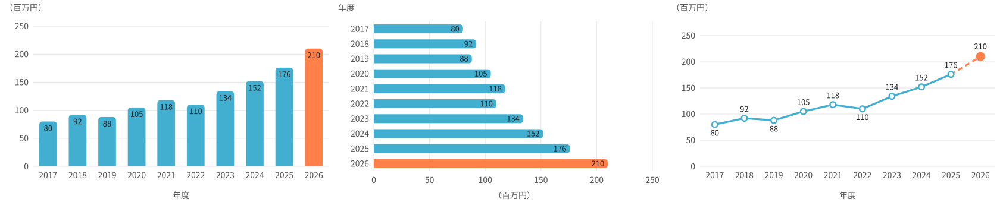

# slides-chart-gas

Googleスライドに「図形で描くグラフ」を作る Google Apps Script です。
スライドの横に出る設定パネルで、コードを触らずに数値・色・種類を変えられます。

## できること

- **3種類のグラフ**：縦棒・横棒・折れ線をボタン1つで切り替え
- **データ入力**：パネルの表で直接編集。Excel やスプレッドシートの2列（ラベル・値）を貼り付けて一括取り込みも可能
- **強調表示**：チェックした棒・点だけ色を変える（折れ線では、強調した点へ向かう線が点線になる）
- **色**：プリセット5種類と、棒・数値・文字・補助線の個別指定
- **表示**：凡例、軸の名称、フォント、文字サイズ、棒の太さ、目盛りの最大と間隔
- **プレビュー**：入力するたびにパネル上部の小さなグラフがすぐ変わる
- **自動で反映**：オンにすると、入力が止まって約1.5秒後にスライドへ反映
- **サイズ追従**：グラフを手で拡大縮小してから反映すると、文字サイズ・余白・線の太さもその大きさに合わせて描き直す

描かれるグラフは普通の図形（角丸長方形・線・円・テキストボックス）をグループにしたものなので、グループを解除して手で色を変えたり、矢印や吹き出しを足したりするのも自由です。

## 導入手順

ファイルは `src/Code.gs` と `src/Sidebar.html` の2つです。

1. Googleスライドを開き、メニューの「拡張機能 → Apps Script」を開く
2. 最初からある `コード.gs` の中身を消して、`src/Code.gs` の内容を貼り付ける
3. 左上の「＋」→「HTML」でファイルを追加し、名前を `Sidebar` にして `src/Sidebar.html` の内容を貼り付ける（名前は大文字・小文字まで同じに）
4. 保存してスライドを再読み込みすると、メニューに「グラフ」が追加される
5. 「グラフ → グラフを編集」を初めて実行すると権限の承認画面が出るので、自分のアカウントで許可する

あとは、グラフを置きたいスライドを開いた状態で、パネルの「スライドに反映」を押すだけです。

## 使うときの注意点

- **設定はファイル単位で1つ**：「スライドに反映」した時点で、そのスライドファイルに保存されます。同じファイルの別のスライドで別データのグラフを作ると、反映したときに上書きされます
- **「初期値に戻す」**：`Code.gs` の `DEFAULTS` に書いた初期データに戻ります（直前の状態に戻るボタンではありません）
- **大きさを変えたら一度反映する**：ドラッグで拡大縮小した瞬間には文字サイズは変わりません。大きさを決めたあとに「スライドに反映」を押すと整います
- **自動反映は開いているスライドに描く**：オンのまま別のスライドで数値を変えると、移動先にもグラフができます
- **自動反映のオン・オフはブラウザごとに記憶**されます
- **マイナスの値には未対応**です

## カスタマイズ

- 初期データや初期の色は、`Code.gs` 冒頭の `DEFAULTS` で変えられます
- 色のプリセットは、`Sidebar.html` の `PRESETS` で変えられます

## ライセンス

[MIT License](LICENSE)
